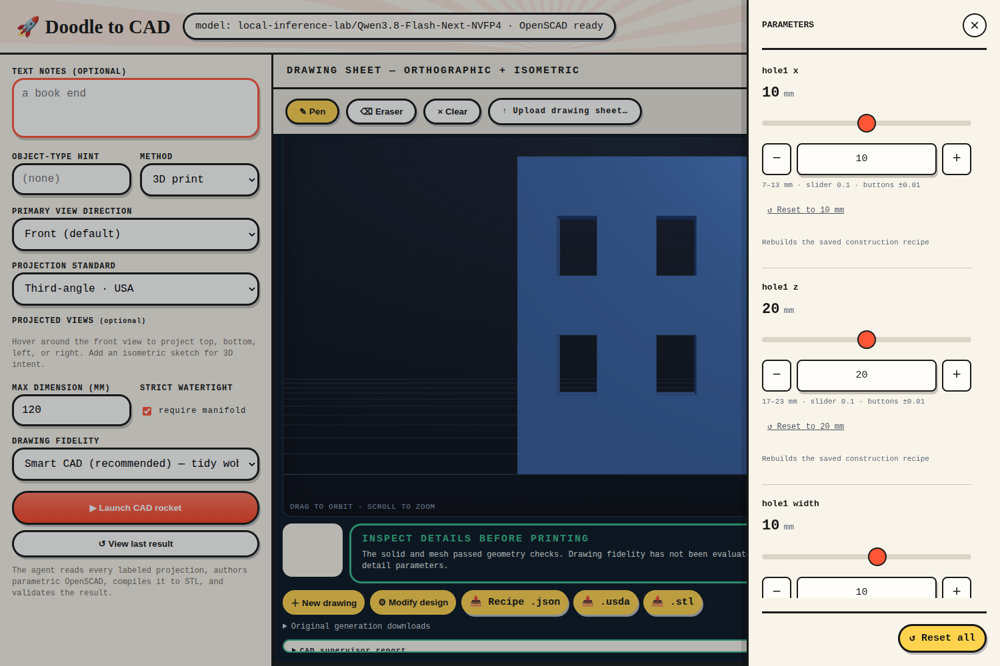

# Optional BRep detail editing

Prototype for [issue #15](https://github.com/nedraki/doodle-to-cad/issues/15).
OpenSCAD remains the drawing-generation default. The optional USD BRep backend
rebuilds exact solids from a saved JSON recipe and exposes its parameters in the
existing Modify design drawer: individual opening positions and sizes, wall
thickness, fillet radius, and curved sweep dimensions.

## Setup

Keep the kernel out of the application environment. From the repository root:

```sh
uv venv --python 3.12 workers/brep/.venv
uv pip install --python workers/brep/.venv/bin/python -r workers/brep/requirements.txt
uv run python run.py
```

The app detects `workers/brep/.venv/bin/python`. Alternatively set
`DOODLE_BREP_PYTHON` to an absolute path to another isolated Python 3.12 executable.
The worker verifies Python 3.12 and `usd-brep==1.0.0` on every build. Each build gets
a fresh process, a 120-second timeout, and unique output files. No kernel objects
or OpenUSD runtime enter the web process. Concurrent requests use separate
processes, never concurrent kernel threads.

## Use on a generated part

1. Generate a part normally, then choose **BRep from original · experimental**.
2. The local model translates the original generation's source and specification
   into a restricted recipe. This is reconstruction, not an exact SCAD importer;
   parameter edits made to the SCAD preview are not the translation input.
3. Inspect the new candidate. Kernel and independent mesh checks establish solid
   validity, **not drawing fidelity or identical feature placement**. The app does
   not carry over the supervisor's acceptance badge.
4. **Modify design** exposes the recipe's detail parameters. Each change rebuilds
   the full operation history; edge selection is recomputed geometrically.
5. Download the displayed STL, recipe JSON, or BRep USDA. Reset restores the original
   BRep candidate. **Back to OpenSCAD result** restores the source generation, also
   after reloading a saved BRep result.

Unsupported translations and failed operations leave the previous result intact.
Builds are published only after solid, mesh, STL reload, and USD round-trip checks.
Unique revision directories keep concurrent/out-of-order builds from overwriting
one another; the existing viewer revision guard rejects stale edit responses.

To exercise deterministic recipes without a model, POST one of
`benchmarks/brep/*.json` to `/api/brep/build`, then use **View last result**:

```sh
curl -H 'Content-Type: application/json' --data-binary @benchmarks/brep/bracket.json \
  http://127.0.0.1:8080/api/brep/build
```

`GET /api/results/{id}/params` and `POST /api/results/{id}/parametrize` support both
backends. BRep responses provide `source` (recipe), `stl`, `usd`, `params`, and
`diagnostics`. They do not mislabel JSON as `.scad`. `GET /api/brep` reports whether
a worker executable is configured; a build verifies the installed kernel.

## Recipe contract

Version 1, units `mm`, at most 64 numeric parameters and 128 operations. Parameters
have `value`, `min`, `max`, and optional `label`, `unit`, `description`, `group`.
Dimension expressions allow only literals, parameter names, parentheses, and
`+ - * /`. The parser walks the AST; it never evaluates generated Python.
Unknown fields, unresolved references, nonfinite values and out-of-range updates
are rejected before execution. Count parameters require integers.

Operations have an `id` and `kind`, plus exactly these fields:

| Kind | Fields |
|---|---|
| `box` | `origin`, `size` (three coordinates/dimensions) |
| `cylinder` | `origin` (base centre), `radius`, `height`, `axis` (`x/y/z`) |
| `union`, `difference` | `left`, `right` (previous operation IDs) |
| `fillet` | `body`, `radius`, `selector` (`all`, `parallel_x/y/z`) |
| `chamfer` | `body`, `radius` (all edges; width across chamfer) |
| `arc_pipe` | `origin`, `bend_radius`, `radius`, `angle` (0–270°, exclusive zero) |

`arc_pipe` sweeps a solid circular section along an XY arc from +X anticlockwise.
The final `output` names a body. Booleans copy their operands so recipe history
remains reusable. Parallel-edge selectors query geometry afresh, not persistent
edge indices. This initial subset does not provide arbitrary clicked-edge edits,
freeform profiles, a sketch constraint solver, general sweeps, or STEP export.
Local parameter highlight regions are not yet emitted for BRep recipes.

## Evaluation and decision

Run the real-kernel tests and deterministic comparison:

```sh
DOODLE_BREP_PYTHON="$PWD/workers/brep/.venv/bin/python" uv run pytest -q
uv run python scripts/evaluate_brep.py
```

Run the issue #34 live backend comparison trials (in-process server, port 8130-8139):

```sh
DOODLE_BREP_PYTHON="$PWD/workers/brep/.venv/bin/python" PYTHONPATH=. \\
  uv run python scripts/evaluate_brep.py trials --plan docs/brep/task-17-comparison/TRIAL-PLAN.json --port 8132
```

See [evaluation.json](evaluation.json) for measured build/edit timings and geometry
results, and [decision-2026-10-13-prototype.md](decision-2026-10-13-prototype.md)
for the 2026-10-13 prototype adoption boundary. The current product-default
decision, measured over 80 live generations, is [DECISION.md](DECISION.md) with
evidence under [task-17-comparison](task-17-comparison/README.md). Mesh artifacts,
recipes, and captured worker warnings are saved under `results/brep-evaluation/`.


