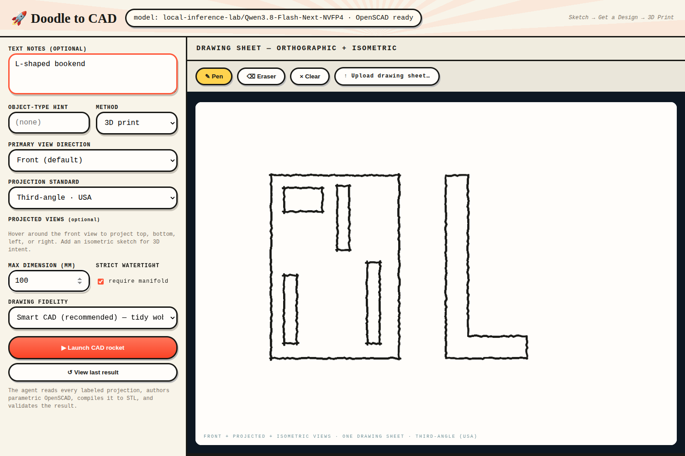
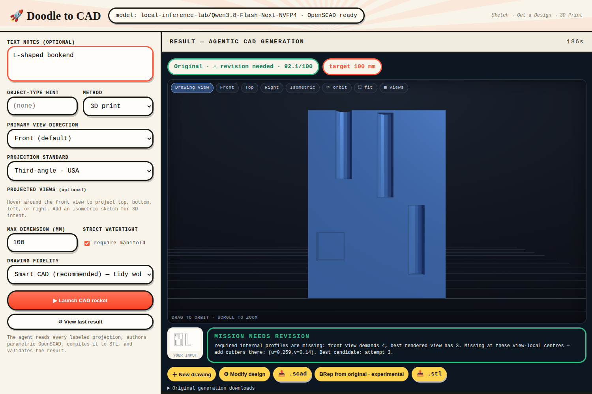
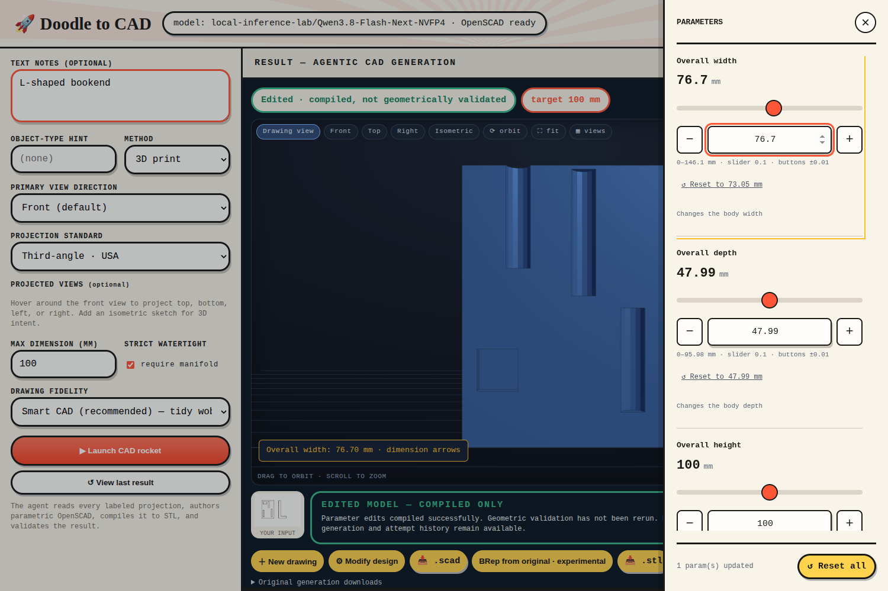
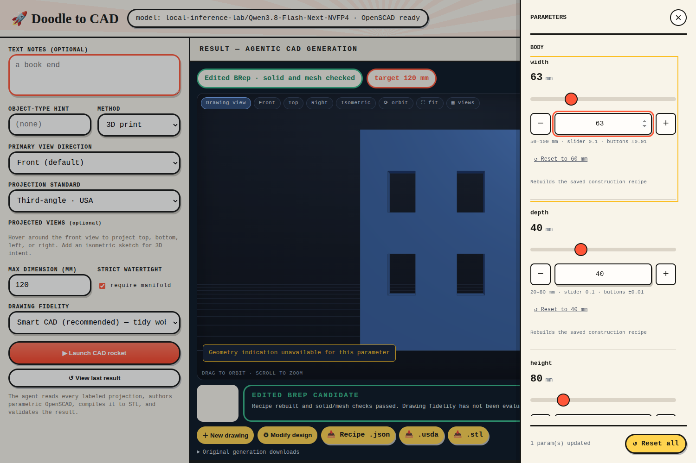

# Task 01 baseline report

Issue: [#18](https://github.com/nedraki/doodle-to-cad/issues/18).
Date: 13 October 2026. User review: **pending**.

## Result

The baseline checks are complete. The product workflow works in this test.
The live generated part fails one drawing feature check. Do not treat this run
as an accepted design or as proof of generation reliability.

| Check | Result |
|---|---|
| Existing regression suite | 71 passed; one existing dependency warning |
| Three BRep reference builds | Passed solid, mesh, and USD round-trip checks |
| Three BRep parameter edits | Passed |
| Three OpenSCAD equivalent models | Connected, watertight, matching dimensions |
| Five reference solids | Connected, watertight, expected dimensions |
| Browser generation | Completed in 186.865 seconds; three attempts |
| Drawing acceptance | **Failed: three detected openings; four required** |
| OpenSCAD parameter edit | Width changed from 73.05 to 76.70 mm |
| BRep parameter edit | Width changed from 60 to 63 mm |
| Invalid input, reset, reload, downloads | Passed product checks |
| Browser script errors | None |

## Integration status

The tested product includes commits `3ef2adc` and `dca43d6`.
At the start of this task, neither commit was in remote `main`.
Remote `main` was `2672a6d`. The prototype branch had no remote branch or pull request.
The task branch is `codex/brep-01-baseline`, based on `codex/brep-detail-editing`.
Review the prototype separately from these baseline artifacts. A baseline report
does not mean that the prototype is integrated or approved for release.

This task changes test scripts, reference fixtures, and documentation only.
It adds no application generation path and no backend selection rule.

## Live OpenSCAD run

The input is the existing `docs/demo/kit_sketch.png`, uploaded through the UI.
The browser sends the canvas image. The exact submitted image is saved in
[generation/input.png](generation/input.png). The notes were `L-shaped bookend`.
The target dimension was 100 mm. This run does not test empty-note inference.

The selected model was `local-inference-lab/Qwen3.8-Flash-Next-NVFP4`.
See [environment.json](environment.json) for non-secret settings and versions.
See [product-checks.json](product-checks.json) for the complete result and checks.

| Attempt | Score | Main failure |
|---|---:|---|
| 1 | 72.4 | Missing openings and poor front projection |
| 2 | 82.4 | Missing or misplaced openings and poor front projection |
| 3 | 92.1 | Front view has three openings; drawing requires four |

The selected mesh is watertight and has one component. Its dimensions are
73.05 × 47.99 × 100 mm. The supervisor correctly keeps the result unaccepted,
even though the numeric score exceeds the acceptance threshold.
The displayed parameter edits are compiled, not rechecked against the drawing.
This existing limitation remains unchanged.

The `generation/` directory retains the input, interpretation, attempt history,
source files, meshes, render images, and diagnostics. No failed attempt was removed.

## Reference cases

The [five-case reference set](../../../benchmarks/brep-baseline/README.md) includes
bookend, wheel, enclosure, curved handle, and transition drawings.
Each manifest defines dimensions, feature positions, connection requirements,
fixed tolerances, and missing information. The new drawings are synthetic
engineering diagrams. They are not evidence of real doodle interpretation.

The wheel has eight connected spokes by test design. It is not a repair of the
user's failed wheel. The transition reference is solid. Its intermediate surface
is intentionally not an exact shape requirement. Review these proposed contracts
before using them to accept future generation changes.

## Reproduce

Use the application environment and the isolated worker documented in
[the setup guide](../README.md). These commands use a separate result directory.
Run the server command in a separate terminal.

```sh
DOODLE_BREP_PYTHON="$PWD/workers/brep/.venv/bin/python" \
  .venv/bin/python -m pytest -q
.venv/bin/python scripts/check_baseline_geometry.py
DOODLE_PORT=8079 DOODLE_RESULTS_DIR=results/baseline-issue18 \
  .venv/bin/python run.py
DOODLE_TEST_URL=http://127.0.0.1:8079 \
  .venv/bin/python scripts/check_baseline_product.py
```

Set `CHROMIUM_EXECUTABLE` if Playwright does not have a usable default browser.
The browser script makes a real model call. It does not mock the model or substitute
a saved result. A new run can produce a different design. Preserve the current
report before rerunning: these commands replace the evidence files.

The geometry script reuses the three existing BRep recipes. It checks the five
reference solids and saves the worker artifacts in `recipe-runs/`.
It does not yet measure every feature position or wall thickness in the manifests.
Those checks remain explicit work for later generation tasks.

## Open work from issue 15

- Direct drawing-to-BRep generation is absent.
- BRep candidates do not use the full drawing supervisor.
- BRep parameters have no local feature highlights or arbitrary face selection.
- SCAD conversion is AI reconstruction and can change the part.
- The worker still emits missing-pxr warnings. Do not install a conflicting runtime to hide them.
- USD import is tested only with usd-brep itself. External application compatibility remains untested.
- No repeated drawing trial establishes acceptance rate or general performance.
- The full recipe, backend contract, packaging, and adoption decision remain open.

## Product demonstration

Input and generated candidate:




Parameter edits in each backend:




Reset screenshots and downloaded artifacts are in this directory.
Their hashes and URLs are recorded in `product-checks.json`.

## Gate decision

Baseline evidence is ready for user review. Keep issue #18 open.
Review the reference contracts and the recorded generation failure.
Do not start task 02 until the user accepts this baseline.

Raw reference and generated files retain their original bytes. Some contain
trailing whitespace. Do not reformat them without updating their provenance.
