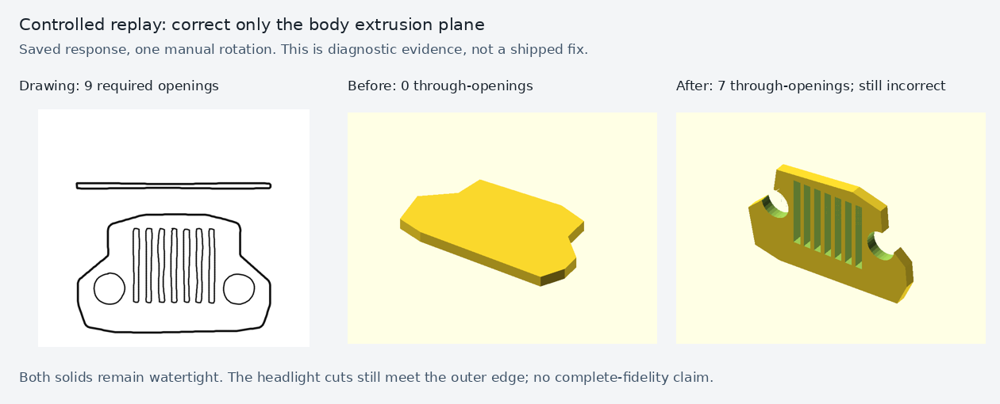

# Supported failure locations in the new baseline

All 24 rows are visible in [the review page](review.html). The table below uses
saved interpretation, construction plans, native sources and mesh measurements.
It does not assign causes from screenshots alone. A missing failure is not a
claim of complete fidelity. Hidden reference dimensions remain excluded from
model blame. `O1/O2` mean OpenSCAD trials; `B1/B2` mean BRep trials.

| Case / trials | Earliest supported finding | Evidence and limits |
|---|---|---|
| Grille O1 | Generated code violates the interpretation's body/cutter coordinate frame. High confidence for that failure. | [Interpretation](runs/003_front_grille_multiview/openscad/trial-01/sketch-spec.json) identifies seven slots plus two headlights and XZ extrusion along Y. [Selected SCAD](runs/003_front_grille_multiview/openscad/trial-01/model.scad) extrudes the body along Z while cutters run along Y. The controlled replay below restores seven tunnels with one rotation; two headlight cuts still hit the edge. A complete causal explanation of every placement error is not claimed. |
| Grille O2 | Generated geometry still loses openings despite correct seven-slot/two-headlight interpretation. | [Interpretation](runs/003_front_grille_multiview/openscad/trial-02/sketch-spec.json), [source](runs/003_front_grille_multiview/openscad/trial-02/model.scad), [row](runs/003_front_grille_multiview/openscad/trial-02/row.json): selected genus 5 vs nine required; historical projection score passes. Precise individual cutter failures remain unresolved. |
| Grille B1 | Construction plan is internally inconsistent about XY vs XZ; generated recipe simplifies the outline and loses two separate tunnels. | [Plan](runs/003_front_grille_multiview/usd-brep/trial-01/construction-plan.json) recognizes all nine openings but calls the front profile XY while describing extrusion along Y. [Recipe](runs/003_front_grille_multiview/usd-brep/trial-01/model.recipe.json) uses a box and nine cutters; [mesh](runs/003_front_grille_multiview/usd-brep/trial-01/row.json) has genus 7. The plan inconsistency is directly observed; it is not asserted to be the sole cause of the final geometry. |
| Grille B2 | Generated recipe rejected for intersecting/touching/self-intersecting profile loops. | [Failure](runs/003_front_grille_multiview/usd-brep/trial-02/error.json), retained [stages](runs/003_front_grille_multiview/usd-brep/trial-02/stages/). No solid published. This is a recorded validation rejection, not evidence of kernel incapability. |
| Plate O1/O2 | No failure established by supplied maximum or visible tunnel count. Reference-only thickness differs. | Both [O1](runs/004_flat_mounting_plate/openscad/trial-01/row.json) and [O2](runs/004_flat_mounting_plate/openscad/trial-02/row.json) have maximum 100 mm and genus 3. Thickness 9.65 mm cannot be called a violation of an unspecified 5 mm reference requirement. |
| Plate B1 | View-orientation scoring failure remains; supplied maximum and three tunnels pass. | [Plan](runs/004_flat_mounting_plate/usd-brep/trial-01/construction-plan.json) deliberately places the plate in XY; [row](runs/004_flat_mounting_plate/usd-brep/trial-01/row.json) records genus 3 and the before/registered IoUs. Matching reference dimensions alone does not certify feature placement. |
| Plate B2 | Generated recipe changes body plane but leaves cutters in the plan's plane. High confidence. | [Plan](runs/004_flat_mounting_plate/usd-brep/trial-02/construction-plan.json) describes an XZ plate and Y-axis cutters. [Recipe](runs/004_flat_mounting_plate/usd-brep/trial-02/model.recipe.json) builds `[width,height,thickness]` in XY, while cutters lie at Z=15/45 and run along Y. The 3 mm-high body cannot intersect those cylinders. [Measured genus](runs/004_flat_mounting_plate/usd-brep/trial-02/row.json) is zero. |
| Angle bracket O1 | Output cuts are not through: selected mesh genus 0 vs three required. | [Row and product failures](runs/007_angle_bracket_holes/openscad/trial-01/row.json), [SCAD](runs/007_angle_bracket_holes/openscad/trial-01/model.scad). Projection similarity passes but topology fails. Full upstream attribution of cutter depth remains unresolved. |
| Angle bracket O2 | No supplied-size or tunnel-count failure established. Hidden depth/height comparisons remain unreliable. | [Row](runs/007_angle_bracket_holes/openscad/trial-02/row.json): maximum 80 mm, genus 3, product accepted. This does not certify complete shape or user acceptance. |
| Angle bracket B1 | Required design detail unresolved after clarification; no part built. | [Failure](runs/007_angle_bracket_holes/usd-brep/trial-01/error.json) and [questions/answers](runs/007_angle_bracket_holes/usd-brep/trial-01/questions.json). Classified unresolved input/planning, not kernel failure. |
| Angle bracket B2 | Construction planning loses the supplied 80 mm maximum. High confidence. | [Plan request](runs/007_angle_bracket_holes/usd-brep/trial-02/stages/construction-plan-request.json) supplies `maximum_dimension_mm:80`; [plan](runs/007_angle_bracket_holes/usd-brep/trial-02/construction-plan.json) specifies 40 mm width/height. [Recipe](runs/007_angle_bracket_holes/usd-brep/trial-02/model.recipe.json) and [mesh](runs/007_angle_bracket_holes/usd-brep/trial-02/row.json) preserve that 40 mm mistake. The new dimension check catches it. |
| Enclosure O1/O2/B1/B2 | All four satisfy supplied 120 mm maximum and one tunnel. Remaining silhouette disagreements are not localized confidently. | Each row under [enclosure](runs/008_open_enclosure_window/) records genus 1. Both BRep historical fidelity checks fail; registration diagnostics and views are retained. Reference-only depth/height/wall choices are not hidden model requirements. No full-fidelity pass is claimed. |
| Handle O1 | Selected maximum 55.438 mm misses supplied 54 mm by 1.438 mm. | [Row](runs/constant_radius_handle/openscad/trial-01/row.json) proves the new size-track failure. Old heuristic axis/projection failures remain confounded by registration; earlier cause of this size error is unresolved. |
| Handle O2 | Generated output has two disconnected components and maximum 48.923 mm vs supplied 54. | [Row](runs/constant_radius_handle/openscad/trial-02/row.json), [SCAD](runs/constant_radius_handle/openscad/trial-02/model.scad). Valid-solid and size checks fail independently. Exact first upstream error remains unresolved. |
| Handle B1 | Recipe does not implement the path placement in its plan. | [Plan](runs/constant_radius_handle/usd-brep/trial-01/construction-plan.json) places the arc centre at `(0,30)` with legs extending toward negative Y. [Recipe](runs/constant_radius_handle/usd-brep/trial-01/model.recipe.json) places the arc at Y=0 and cylinders along positive Y. [Mesh](runs/constant_radius_handle/usd-brep/trial-01/row.json) maximum is 48 instead of 54 mm. This is source-level placement evidence, not a claim that a new operation is required. |
| Handle B2 | Supplied maximum passes; complete drawing fidelity unresolved. | [Row](runs/constant_radius_handle/usd-brep/trial-02/row.json) maximum 53.994 mm; [plan](runs/constant_radius_handle/usd-brep/trial-02/construction-plan.json) is XY-planar. Historical projection failure alone is insufficient to blame shape. |
| Wheel O1/O2 | Reproduced evaluator false rejection: measured maximum 120 mm and genus 8, but a 27.8 mm inferred axis expectation rejects both. | [O1](runs/wheel/openscad/trial-01/row.json), [O2](runs/wheel/openscad/trial-02/row.json) record the exact product failure. Do not treat undimensioned reference rim/spoke widths as user requirements. |
| Wheel B1/B2 | Supplied maximum and genus 8 pass; historical drawing checks remain unreliable for this case. | [B1](runs/wheel/usd-brep/trial-01/row.json), [B2](runs/wheel/usd-brep/trial-02/row.json), saved plans and recipes. Neither topology nor the orientation diagnostic certifies spoke placement or full drawing agreement. |

## Controlled saved-response intervention

`replay_grille_frame.py` changes only the body extrusion's plane in a retained
response; it never feeds a reference or corrected source into a live model trial.
Before: one watertight component, zero through-holes. After: one watertight
component, seven through-holes. Both fail the required nine-opening target.
The headlight cutters still reach the outer edge. This localizes one real
construction-code error without presenting the intervention as a production fix.

## Separate deterministic application defect

[Issue #104](https://github.com/nedraki/doodle-to-cad/issues/104) tracks a reproduced
feature-identity error in equal-size snapping. The full synthetic input and
observed output are in [refinement-reproducer.json](refinement-reproducer.json).
Two rectangles should become width 0.21 while a circle stays width 0.10; instead
the circle becomes 0.21 and one rectangle remains 0.22. This occurs before model
generation. Its contribution to individual live failures has not been isolated,
so those failures are not all attributed to it.

## Remaining work

- User review of the full visual baseline is pending; issue #81 remains open.
- Joint orientation is a validated diagnostic, not a calibrated acceptance gate.
- Actual doodle feature-position extraction, wheel opening extraction and the
  erroneous inferred-axis rejection still require focused fixes/evaluation.
- Several output failures above remain unresolved at earlier stages; no blanket
  model-versus-pipeline explanation is supported.
