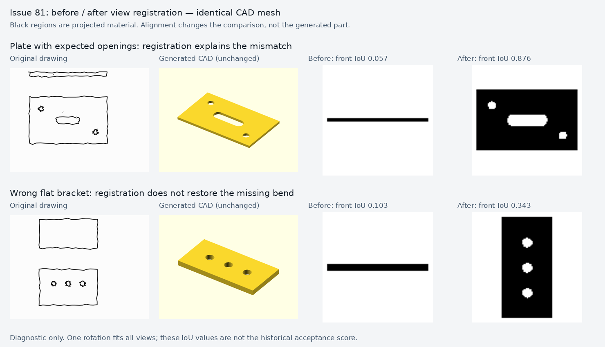

# Issues 81 and 102: evaluator follow-up

This work improves what the benchmark can measure. It does not claim that the
model recognizes drawings better or that the generated solids changed.

## Supplied dimension (#102)

The shared `scripts/evaluate_brep.py:reference_checks` compares the mesh maximum
extent against the dimension actually supplied in the plan: absolute error at
most 1 mm, inclusive. 119 mm passes for 120 mm; 118.5 and 121.5 mm fail. This is
independent of reference-only dimensions and of the historical `overall_pass`.
No historical row is rewritten. Missing inputs are not applicable, absent or
invalid mesh measurements fail, and invalid targets/tolerances raise an error.
The new plan revision and historical manifest declare the additional track.
Clarification-provided dimensions remain outside this track, as requested.

## Orientation (#81)

The old probe selected a different best rotation for each view. The new
benchmark-only prototype tries the 24 proper cube rotations and selects **one
rotation for all registered views**, maximizing the worst-view IoU and then the
mean. It rasterizes triangle silhouettes, preserving visible openings, and
compares material masks at the same normalized resolution. It neither reflects
nor deforms the mesh, nor changes its dimensions, topology, volume or source.

This is a new silhouette-IoU metric. The historical score combined profiles,
edges and extracted opening positions. Its 0.45 threshold is **not** reused.
No new pass threshold is claimed or used. The output is diagnostic only and
cannot change either product acceptance or historical `overall_pass`.

The comparison uses the same CAD bytes in both columns. The plate front IoU
changes from 0.057 to 0.876; its top changes from 0.060 to 0.584. A control plate
already facing front remains similar (0.880 to 0.884). The incorrect flat
bracket's best common pose still has poor front/top overlap (0.343/0.248).
The wheel front stays at 0.313: orientation does not explain its mismatch.
`replay.json` retains all 24 candidate poses, source row hashes, input hashes,
mesh hashes, historical scores and new scores. `replay.py` verifies the mesh and
input against the archived row/request before scoring.

## Validation boundaries

- A rotated asymmetric synthetic part recovers all three views exactly.
- Three views individually satisfiable at different rotations cannot be
  combined into a false perfect score.
- A missing body remains geometrically different after registration.
- Real OpenSCAD fixtures cover a known-correct plate, removed opening, blind
  opening, disconnected body, moved opening and changed stated thickness.
- Genus/extents/volume remain unchanged for the moved-hole fixture; the
  independent projected opening-centre measurement detects its 20 mm shift.
- The 3 mm thickness fixture is a defect only when 5 mm is explicitly stated.
  In historical 004 trials that number was hidden, so it remains an unreliable
  model-quality requirement.

Position extraction and view assignment from actual doodles remain uncertain.
The opening-centre diagnostic is not a one-to-one feature matcher. Silhouettes
cannot prove unseen construction or distinguish every blind/through feature;
mesh topology and explicit feature requirements remain separate checks.

## New baseline and preserved interruption

`TRIAL-PLAN.json` freezes six existing drawings, both backends and two trials per
cell before generation. Notes, maximum dimensions and clarification policy are
recorded; no reference geometry is sent to the model. The supplied dimension is
checked separately. Hidden reference dimensions and the known wheel extraction
problem retain their limitations from `../CASES.json`.

The initial environment attempt was interrupted after the full regression suite
found that `/tmp/doodle-usd-review-venv` lacked the graph dependency used by mesh
checks. `aborted-environment-run/` preserves requests and both partially generated
runs, the harness log and failing regression output. It is an infrastructure
interruption, not a model-quality outcome. Planned request files for queued
cells do not establish that they were submitted. The replacement run is a new,
explicitly recorded environment revision, not a deletion or replacement of
individual unfavorable results.

The final baseline and user review are reported separately in `RESULTS.md` and
`review.html`. User acceptance is pending; automatic scores do not supply it.
