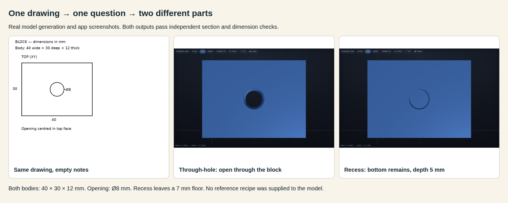
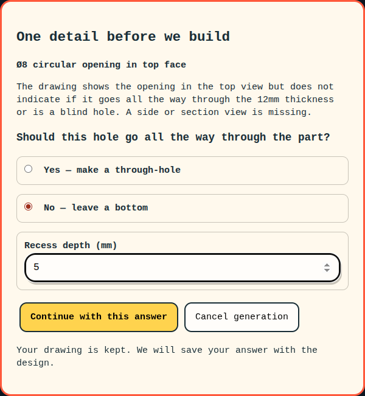

# Task 08 — ask before guessing an opening

Issue #25. Base branch: `brep-integration` at `da94850`. Task branch: `codex/brep-08-clarification`. `main` is unchanged.

Implementation commit: `cd1f0ca`. PR [47](https://github.com/nedraki/doodle-to-cad/pull/47), targeting `brep-integration`. User review and merge remain pending.

## What changed

A top-view circle can mean a through-hole or a recess. The experimental BRep path now pauses before building when the construction plan identifies that missing choice. It names the opening and asks whether it goes through. A recess requires a depth in millimetres. The original image and measured evidence stay in the same job. The answer is saved and the construction plan is updated before recipe generation.

The first version supports opening extent questions. It can ask about at most three different openings, one at a time. It does not provide arbitrary questions or upload of an extra view during a paused job. Other plan uncertainties continue through the existing recipe planner. That planner must disclose permitted assumptions or retain unresolved recipe evidence, which the existing validator rejects. No recipe or geometry validation is bypassed.

## Visible evidence





## Live acceptance trials

All four use the real model through the browser. Notes are empty. The synthetic drawings are saved in `benchmarks/brep-clarification`; expected geometry enters only the later measurement code, never the model request.

| Case | Job | Questions | Result | Expected flow and geometry |
|---|---|---|---|---|
| through | `08adec0bcbda` | 1 | done | passed |
| recess | `c45637eba8d5` | 1 | done | passed |
| clear | `d16e688a2c06` | 0 | done | passed |
| cancel | `877ba48d539a` | 1 | cancelled | passed |

The ambiguous drawing produced one question in each answered run. Selecting through-hole made a hole through the full 12 mm thickness. Selecting recess and entering 5 mm left a 7 mm floor. Both retained the 40 × 30 × 12 mm body and centred Ø8 opening. The explicit section drawing generated a through-hole with no question. Cancelling the question saved the cancelled question and no completed result.

Measurements use exported STL sections at Z = 1, 6, 8 and 11 mm, boundary tolerance 0.25 mm, outer-dimension tolerance 0.25 mm and volume tolerance 10 mm³. The section tests distinguish an empty hole from a remaining floor. Mesh tessellation makes volume approximate. All three generated outputs are watertight and have one connected component. The app still reports detailed drawing acceptance separately; these specific offline checks do not silently override its warnings.

[Full measurements](trial-03/summary.json). Each case directory contains inputs, questions, screenshots, raw model responses, answer history, recipe, STL, USDA and diagnostics. The `artifacts` subdirectory preserves the exact submitted image after browser processing.

## Compatibility probes

The agreed wheel, bookend and knob were included, with the saved cable holder and one random case selected before generation. [Selection and fixed random seed](regressions/selection.json). A question in this probe is saved and cancelled, rather than answered with an invented design choice. These are single trials, not reliability estimates.

| Input | Result | Asked a question | Drawing status / error |
|---|---|---|---|
| regressions: wheel | error | False | More drawing information is needed: Rim width is not dimensioned; assumed 10 mm.; Hub diameter is not dimensioned; assumed 30 mm.; Spoke width is not dimensioned; assumed 10 mm. |
| regressions: bookend | cancelled | True | Recipe job cancelled |
| regressions: knob | error | False | More drawing information is needed: The thickness (Y-axis dimension) is not specified in the drawing. An assumption of 10mm is used for the plan.; The specific proportions of the flanges vs. the web (e.g., flange height vs. web height) are estimated from the visual aspect ratio. |
| regressions: cable_holder | error | False | More drawing information is needed: Exact dimensions of the main body (width, height, depth) are not provided.; Exact dimensions and positions of the side holes are not provided.; Exact dimensions of the notches and central hole are not provided. |
| regressions: random_005_bolt_flange | error | False | More drawing information is needed: Exact dimensions for all features are assumed based on visual proportions; Front view aspect ratio is assumed to represent actual thickness |
| regressions-02: wheel | error | False | More drawing information is needed: Rim width (radial thickness) is not dimensioned; assumed 10 mm.; Hub diameter is not dimensioned; assumed 30 mm.; Spoke width is not dimensioned; assumed 8 mm. |
| regressions-02: knob | error | False | Construction plan rejected: Unsupported clarification or unknown feature |
| regressions-03: wheel | done | False | failed |
| regressions-03: bookend | cancelled | True | Recipe job cancelled |
| regressions-03: knob | done | False | failed |
| regressions-03: cable_holder | done | False | failed |
| regressions-03: random_005_bolt_flange | done | False | failed |

The initial full probe uses construction-intent-3. Targeted repeats in regressions-02 use construction-intent-4. Both stopped too early on plan uncertainties. Final regressions-03 and trial-03 use construction-intent-5 and drawing-brep-11: opening questions pause the job, while other uncertainties go through the existing recipe validation. Every prior attempt is retained.

## Development trial history

- [trial-01](trial-01/summary.json): through: done, recess: done, clear: done, cancel: cancelled
- [trial-02](trial-02/summary.json): through: done, recess: done, clear: done, cancel: cancelled
- [trial-03](trial-03/summary.json): through: done, recess: done, clear: done, cancel: cancelled

## Tests and limits

- The full suite passes 141 tests with the isolated BRep worker enabled. See [tests.txt](tests.txt). One existing Starlette/httpx deprecation warning remains.
- New tests cover invalid and stale answers, depth validation, answer persistence, cancellation, clear plans, unresolved plans, retaining waiting jobs, and reusing measurements. Human response time does not consume the preparation timeout.
- The worker still checks the built solid and mesh. A saved answer is design intent, not proof that every model-generated recipe follows it.
- The model decides whether the opening is ambiguous. These synthetic examples pass; arbitrary doodles and multiple ambiguous openings are not proven by this trial.
- The initial wheel, knob and cable-holder probes stopped on unresolved dimensions. The prompt-only revision did not reliably solve this. The final change removes the overly broad new plan-level stop, preserving the existing recipe-level unresolved-value validation. Follow-up outcomes are shown above; this does not establish reliable interpretation for arbitrary drawings.
- Pending questions are held in the in-memory job registry. A server restart interrupts a pending job; this task does not add persistent job recovery.
- The existing OpenSCAD generation path is unchanged and remains the default. No fresh live OpenSCAD generation is claimed here; regression coverage is from the test suite.
- The first evidence runner stopped after the through-hole build because it was invoked as a script and imported the old editable package. It was rerun as a module and measured the same saved job; no replacement generation was selected. A separate probe runner exited with status 143 and resumed its saved wheel job. Both interruptions are recorded in the runner logs.

## Reproduce

Use the task checkout and its app environment. Configure the isolated worker through `DOODLE_BREP_PYTHON`. Start the app with `DOODLE_RESULTS_DIR=results/brep25` on port 8095.

```sh
python -m pytest -q
python -m scripts.draw_clarification_cases
python -m scripts.check_clarification_product
python -m scripts.check_clarification_regressions
python -m scripts.report_clarification
```

The product runner resumes saved jobs in the selected trial directory. Use a new `BREP_TRIAL` value for new generations. Set `BREP_TRIAL` for the report to select the displayed acceptance trial. Keep previous attempts.
