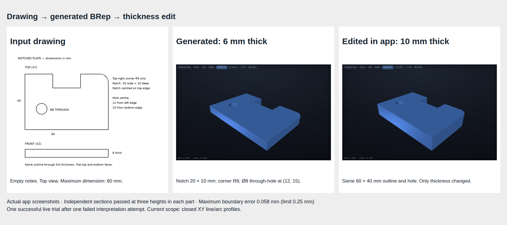

# Task 09 — generate a solid from a drawn profile

Issue: #26. Target branch: `brep-integration`. Task branch: `codex/brep-09-profile-extrusion`.
Base: `02171dcecd367468c9a979301c67209bf3b62875` (merged PR #47).
`main` is not part of this change.

## What the user gains

A flat part can now keep its drawn outline as one editable profile. The new operation extends that outline to make a solid. Lines, circular arcs and inner openings are supported.

The demonstration uses a 60 × 40 mm plate. It has a 20 × 10 mm notch, one R6 corner and an Ø8 through-hole at (12, 15) mm. The model reads the drawing with empty notes. The user then changes thickness from 6 to 10 mm in the existing parameter drawer. The outline, notch, corner and hole stay fixed.



This is a new generation operation as well as an edit capability. The model generated an `extrude` operation from the drawing. The reference recipe was not sent to the model. This demonstration does not prove that every drawing will be interpreted correctly.

## Measured results

| Check | Generated | Edited |
|---|---:|---:|
| Bounds, mm | 60 × 40 × 6 | 60 × 40 × 10 |
| Connected solids | 1 | 1 |
| Watertight mesh | Yes | Yes |
| Mesh volume, mm³ | 12852.905 | 21421.508 |
| Analytical expected volume, mm³ | 12852.053 | 21420.089 |
| Largest section boundary error, mm | 0.05601 | 0.05756 |
| Fixed boundary tolerance, mm | 0.25 | 0.25 |

The independent check uses the dimensions from the drawing, not the generated recipe. It compares sections near the bottom, at mid-height and near the top. Each section must contain the full outer outline and the correctly placed hole. The test also checks the volume and bounds. A plain box of the same overall size fails this check.

The native worker checks solid validity and reloads its USD export before publishing the result. The live app check also verified matching downloads, rejection of an out-of-range edit, retention of the displayed valid part and restoration of the original result after reload. There were no browser errors. Edits are still temporary: durable revision history belongs to #30.

The app's general image comparison **still marks this drawing as failed** (`top openings`). It expects more openings than the part contains; contours from the annotated sheet appear to contribute to that mismatch. The saved independent geometric checks pass the dimensions and features stated above. We did not change the app's check, lower its threshold or replace its status with a success badge.

## All live attempts

Model: `local-inference-lab/Qwen3.8-Flash-Next-NVFP4`.
Recipe prompt: `drawing-brep-12`. Construction plan: `construction-intent-6`.
Server: separate port 8099; results directory `results/brep26`.

| Attempt | Result | Evidence |
|---|---|---|
| Plate trial 01 | Stopped before recipe generation. Feature interpretation returned invalid relationship fields, including after its retry. | [Saved failure and model responses](trial-01/) |
| Plate trial 02 | Generated profile, native build and UI thickness edit passed the independent feature checks. | [Measurements](trial-02/report.json), [whole result](trial-02/result.png), [edited result](trial-02/edited-result.png) |

Successful native files: [original STL](trial-02/original.stl), [original USD BRep](trial-02/original.usda), [original recipe](trial-02/original.recipe.json), [edited STL](trial-02/edited.stl), [edited USD BRep](trial-02/edited.usda), [edited recipe](trial-02/edited.recipe.json).

Each trial directory contains its request, job state and the saved server artifacts. These include model responses, the construction plan, build diagnostics and drawing checks where available.

## Regression probes

The fixed set is wheel, bookend, knob and cable holder. A seeded draw selected `004_flat_mounting_plate` before generation. Seed: `20261016`. See [selection](regressions/selection.json) and [results](regressions/summary.json).

| Drawing | What happened | What this proves |
|---|---|---|
| Wheel | Built; drawing checks failed. | The build path ran. Drawing fidelity is not accepted. |
| Bookend | Asked about an opening. The probe saved the question and cancelled. | Clarification remains available. No geometry success is claimed. |
| Knob | Built; drawing checks failed. | The build path ran. Drawing fidelity is not accepted. |
| Cable holder | Cut `part_with_slot1` produced an invalid solid. | The failure remained visible. No fallback part was published. |
| Random mounting plate | Asked whether the central slot goes through. The probe saved the question and cancelled. | The probe did not invent an answer. |

[Wheel image](regressions/wheel/result.png) · [Knob image](regressions/knob/result.png). All inputs, questions, failed attempts and available native files are in the case directories. No completed native model exists for a cancelled or failed job.

The cable-holder recipe uses only the existing box, cylinder and difference operations. Replaying that exact recipe on commit `4595511` (PR #47 before the new profile work) produced the same `part_with_slot1` error: [baseline replay](cable-baseline-replay/report.json). This isolates that build failure from the new extrusion implementation. It does not prove that the new prompts have no effect on generation. These five probes are not a clean drawing-fidelity regression pass.

## Supported scope and limits

- Profiles lie in XY. Extrusion runs along positive or negative Z. An origin translates the result.
- The outer outline comes first. Up to 15 inner loops define through-openings.
- Profiles contain ordered line segments and counterclockwise circular arcs. A complete circle uses one arc.
- At most 128 edges and 8192 sampled validation points. Dimensions use the existing bounded arithmetic expressions.
- Open, intersecting, touching, nested or overlapping loops are rejected before construction. Unsupported spline edges and other profile planes are rejected.
- Intersection checks use analytical line/circle calculations with numerical tolerances. Containment uses sampled arcs (0.001 mm chord error). This is bounded engineering validation, not exact symbolic geometry.
- Initial XZ and YZ native tests failed the USD volume round-trip check. Their output is retained in [initial-axis-tests.txt](initial-axis-tests.txt). Those planes are not enabled. The export check was not weakened.
- Do not rotate an extruded profile to work around this limit. General rotated profile support needs its own export verification. Existing final export checks still apply to recipes that use rotation.
- Loft, spline fitting, arbitrary sweeps and general post-generation repair are outside this task.
- The automatic construction-correction pass retains profile structure. Thickness changes use its existing parameter mechanism; this task does not add automatic profile repair.

## Tests and reproduction

[Full test log](tests.txt): **158 passed**, one existing Starlette/httpx deprecation warning. This includes the existing OpenSCAD tests. The implementation does not change OpenSCAD generation or its default selection.

[Reference checks](reference/report.json): fixed recipe at 6 and 10 mm, with a negative plain-box control. The worker API probe is saved in [kernel-probe.txt](kernel-probe.txt).

From this checkout, with the app environment installed and `DOODLE_BREP_PYTHON` set to the isolated worker Python:

```sh
.venv/bin/python -m pytest -q
.venv/bin/python -m scripts.check_profile_reference
DOODLE_RESULTS_DIR=results/brep26 .venv/bin/uvicorn doodle_to_cad.app:app --port 8099
# In another terminal; use a NEW trial name to retain previous attempts:
BREP_TRIAL=trial-03 .venv/bin/python -m scripts.check_profile_product
BREP_REGRESSION=regressions-02 .venv/bin/python -m scripts.check_profile_regressions
```

The browser scripts currently use the installed Chromium path shown in their source. The regression script uses empty notes and cancels unanswered clarification requests. The image sheet is composed from actual browser screenshots with `scripts.capture_profile_evidence`; it is not an imagined render.

## Review gate

The profile demonstration and automated checks are ready for review. Keep issue #26 open until user review. Do not begin #27 or merge this change merely because a solid was built. The general drawing-check mismatch, failed regression outputs and XY-only export limit must remain visible in the review.
