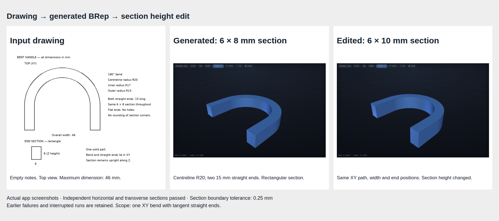

# Task 10 — a rectangular section through a curved path

Issue #27. Task branch: `codex/brep-10-sweep`. Base: `081a330` on `brep-integration`. Main is unchanged.

## Practical change

The previous curved-pipe operation always used a circular section. A handle with a rectangular end view needs a different construction. The new `sweep` operation carries a rectangle along one circular bend, with optional straight ends that meet the bend smoothly.

The test drawing specifies a 180° bend with centreline radius 20 mm, two 15 mm straight ends and a 6 × 8 mm rectangular section. The outside width is 46 mm. Changing section height to 10 mm must preserve the 6 mm width, XY path and end positions.

The first version supports XY paths. The rectangle stays upright along Z, normal to the path. It does not support arbitrary 3D paths, splines, multiple bends, variable sections or sharp path joints. Those inputs fail explicitly. The old round `arc_pipe` operation remains available for round sections.



## Live app result

Trial 05 (`8f7f9e2e4b27`) generated an actual `sweep` from the drawing with empty notes. The current parameter drawer changed section height from 8 to 10 mm. All six independent section checks passed for each version. Largest boundary errors were 0.05621 and 0.05647 mm, below the fixed 0.25 mm limit. Bounds were 46 × 38 × 8 mm and 46 × 38 × 10 mm. Both meshes are watertight and contain one connected solid.

The app's general drawing checks report **unverified**, with no failed projection checks. Detailed feature acceptance comes from the independent measurements, not that general status. An invalid edit was rejected, the last valid display stayed visible, downloads matched the viewer, and reload restored the original result. There were no browser errors. Persistent edit history remains task #30.

[Measurements](trial-05/report.json) · [Original STL](trial-05/original.stl) · [Original USD BRep](trial-05/original.usda) · [Original recipe](trial-05/original.recipe.json) · [Edited STL](trial-05/edited.stl) · [Edited USD BRep](trial-05/edited.usda) · [Edited recipe](trial-05/edited.recipe.json).

## Kernel and geometric checks

The installed usd-brep 1.0.0 API provides `sweep_along_planar_path`. Its section-centre placement option is necessary: the saved [probe](probe.txt) shows that anchoring the first profile point produces the wrong volume and placement. The worker uses the tested centre placement and caps both ends.

The worker retains manifold, independent mesh, connectedness, bed placement and USD export/reload checks. The validator requires one circular arc with angular magnitude 1–180°, with zero, one or two tangent straight ends. It checks continuity, tangent direction, dimensions and the bend's clearance from the inside of the section before launching the kernel.

[Reference results](reference/report.json) compare the actual mesh against contours declared independently from the drawing:

- Three horizontal sections check the full U-shaped outline.
- Two sections across the straight ends check both rectangles and their positions.
- One section normal to the bend at 45° checks the rectangle through the curve.
- Bounds, volume, watertightness and one connected solid are required.
- A plain box of the same overall size fails the feature check.

The fixed section boundary tolerance is 0.25 mm. Reference results at heights 8 and 10 mm pass, with maximum measured error below 0.057 mm. Expected volume is `6 × height × (30 + 20π)` mm³.

[Automated tests](tests.txt): 175 passed, with one existing Starlette/httpx deprecation warning. Native tests cover clockwise and counterclockwise traversal, the full handle, the height edit and quarter bends starting at 0°, 45° and 90°. Invalid-path tests cover gaps, backwards and sharp joins, multiple bends, unsupported planes and oversized sections. Existing OpenSCAD tests remain included.

Clockwise authored paths are supported by reversing the entire validated chain before calling the kernel. This preserves its geometry. Optional straight ends are also reversed when their endpoint order is opposite to the arc connection. This never moves a point or changes a line’s locus. Gaps and incorrect tangent joins still fail. The authored recipe stays unchanged. A direct negative-angle kernel call failed ([probe](clockwise-probe.txt)); the canonical reversal passes the same independent section checks as counterclockwise input.

## Trial record

The first product trial and first wheel probe were interrupted when the separate test server received SIGTERM. The cause was not established. The server log and client errors are retained. In-progress staging directories were removed by cancellation, so there are no completed native files for those attempts. They are not counted as geometry failures or successes.

Fresh trials use a separate server on port 8100 and result directory `results/brep27`. Model: `local-inference-lab/Qwen3.8-Flash-Next-NVFP4`. Latest recipe prompt: `drawing-brep-16`; construction plan: `construction-intent-9`. Trials 01/02 and regression set 02 used prompt 13/plan 7. Trial 03 used prompt 14/plan 8. Trial 04 and regression set 03 use prompt 15/plan 9. Trial 05 and regression set 04 use prompt 16/plan 9. The latest test server uses port 8101. The reference recipe is never sent to the model.

The regression set is wheel, bookend, knob and cable holder plus `007_angle_bracket_holes`, selected before generation with seed 20261017. The seed is an identifier, not the trial date. Probes save questions and cancel without inventing an answer. Available staged evidence is copied before cancellation.

Trial 02 selected the lower semicircle and failed the tangent check at both straight joins. Trial 03 described the correct clockwise shape but failed the original positive-angle restriction. Trial 04 had a correct clockwise arc but reversed the first line; its retry changed the arc incorrectly and failed the tangent check. Endpoint-order normalization now handles that first representation without changing the shape. Those attempts and model responses are saved. Error messages now name the feature and show the mismatched tangent vectors. The schema now accepts either traversal direction and canonicalizes it as described above.

## Final regression set

[Set 04 results](regressions-04/summary.json) use the final prompt and include all five agreed cases. Wheel built but failed drawing checks. Bookend, knob, cable holder and the random angle bracket requested clarification; those requests were saved and cancelled without invented answers. These are compatibility probes, not five accepted drawings. Earlier sets and their outputs are retained separately. The implementation does not claim to fix the existing drawing-interpretation limits.

[Wheel screenshot](regressions-04/wheel/result.png). For cancelled runs, the saved case directory includes the question and available staged model evidence; no completed native part is claimed.

## Reproduction

Use the app environment and set `DOODLE_BREP_PYTHON` to the isolated Python 3.12 worker with usd-brep 1.0.0.

```sh
.venv/bin/python -m pytest -q
.venv/bin/python -m scripts.check_sweep_reference
DOODLE_RESULTS_DIR=results/brep27 .venv/bin/uvicorn doodle_to_cad.app:app --port 8100
# Separate terminal. Choose new output names to retain earlier attempts.
BREP_TRIAL=trial-03 .venv/bin/python -m scripts.check_sweep_product
BREP_REGRESSION=regressions-03 .venv/bin/python -m scripts.check_sweep_regressions
```

Browser scripts use the installed Chromium path in their source. Saved native files and actual app screenshots are the evidence; a valid build alone does not establish drawing fidelity.
