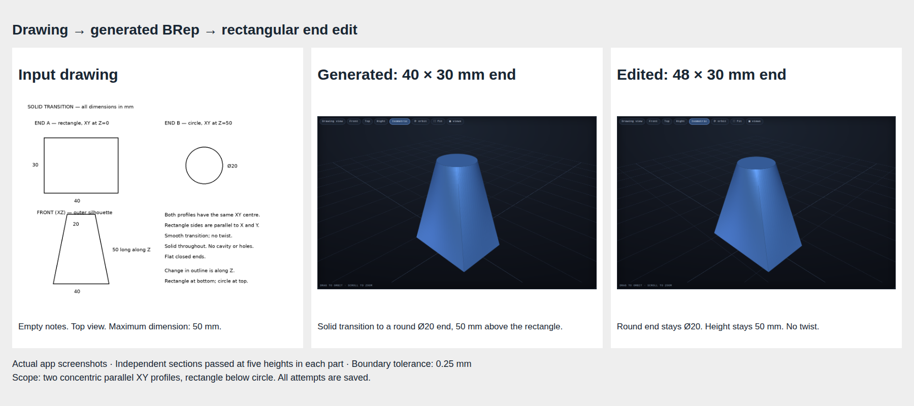

# Task 11 — a solid transition from rectangle to circle

Issue #28. Branch `codex/brep-11-loft`, based on `71f955f` in `brep-integration`. Main is unchanged.

## Practical change

A part that changes outline along its length needs a loft. The new operation joins a 40 × 30 mm rectangular end to a round Ø20 mm end, 50 mm above it. Both end centres have the same X and Y coordinates. The app edit changes only rectangular width, from 40 to 48 mm.

This is a solid part with closed ends. It is not a hollow duct. This first operation supports exactly two parallel XY profiles: rectangle below circle. The rectangle's corners match the circle's diagonal points in a fixed order. Offset or rotated profiles, extra sections, hollow profiles and other profile shapes are rejected.



## Live app result

Trial 01 (`9c190363732f`) passed on the first generation attempt. The model generated a `loft` operation with empty user notes. The parameter drawer changed `base_width` from 40 to 48 mm. The circular end remained Ø20, the other rectangular dimension remained 30 mm and the separation remained 50 mm. All five full-boundary section checks passed for each version. Largest boundary errors were below 0.050 mm against a fixed 0.25 mm tolerance.

Both parts were watertight and connected. The worker passed native export and reload. The browser check confirmed matching downloads, rejection of an invalid edit, retention of the valid display and restoration of the original result after reload. No browser errors occurred. Durable revisions are still a later task.

The app's general image checks flag a **right-projection mismatch** on this annotated multi-profile sheet. This status was not changed or hidden. Independent geometric measurements provide the detailed feature evidence; a successful build alone would not.

[Measurements](trial-01/report.json) · [Original STL](trial-01/original.stl) · [Original USD BRep](trial-01/original.usda) · [Original recipe](trial-01/original.recipe.json) · [Edited STL](trial-01/edited.stl) · [Edited USD BRep](trial-01/edited.usda) · [Edited recipe](trial-01/edited.recipe.json).

## Native API and independent checks

The installed usd-brep 1.0.0 `create_skin_primitive` API builds four matching boundary segments per end. The worker uses a degree-1 loft and caps both ends. Rectangle corners NE/NW/SW/SE match circular points at 45°/135°/225°/315°. The installed arc API rejects an end angle above 360°. The worker now normalizes periodic arc angles without changing their sweep; the last circular segment therefore uses the equivalent -45° to 45° range. This also fixes supported sweep/profile arcs that cross 360°. Native tests cover a quarter bend from 315° to 405° and an extrusion profile shifted by 360°. The initial failed probe and corrected native probes are saved.

The worker retains its solid, mesh, connectedness, bed placement and native USD export/reload checks. It does not heal or replace a failed body.

The independent reference checker constructs expected contours from the stated end dimensions and the fixed correspondence. It checks sections at Z=0.1, 12.5, 25, 37.5 and 49.9 mm. The test compares the full boundary, not only bounds or operation names. A separate volume estimate integrates the end and midpoint areas. A plain box with the same bounds fails the check.

The first mesh used long triangles over the transition. The 48 mm edit failed the fixed 0.25 mm boundary tolerance, with a 0.26536 mm error. That result is retained in [reference-initial-report.json](reference-initial-report.json). A 2 mm edge subdivision target for recipes containing lofts reduced the error below 0.050 mm for both widths. The geometric acceptance tolerance remains 0.25 mm. Existing operations retain their previous tessellation settings when no loft is present.

[Reference measurements](reference/report.json) and native files are saved for both widths. The original native volume is 35690.708 mm³. Native export and reload return the same volume. The mesh approximates that geometry and is checked separately.

## Tests

The full suite passed 187 tests, with one existing Starlette/httpx deprecation warning. The 10 loft tests also passed after adding full independent section checks to the native test. They cover original and edited shapes and reject unsupported planes, correspondence, offsets, zero separation, reversed profiles, zero dimensions, extra profiles and rotation fields. Existing OpenSCAD tests remain included.

## Live trial and regression setup

Use the drawing with empty notes, top-view controls and maximum dimension 50 mm. The reference recipe is never model input. Model: `local-inference-lab/Qwen3.8-Flash-Next-NVFP4`. Recipe prompt: `drawing-brep-17`. Construction plan: `construction-intent-10`.

The separate test server uses port 8103 and `results/brep28`. The regression set contains wheel, bookend, knob, cable holder and a seeded random selection, `103_y_motor_holder`. Seed 20261018 is a selection identifier, not a trial date. Questions are saved and cancelled without invented answers. Available staged evidence is copied before cancellation.

## Final regression outcomes

[All five results](regressions/summary.json) are saved with their inputs and available native artifacts.

| Case | Outcome |
|---|---|
| Wheel | Built; general drawing checks failed. |
| Bookend | Requested clarification; saved and cancelled without guessing. |
| Knob | Built; no failed projection check, but detailed drawing fidelity remains unverified. |
| Cable holder | Requested clarification; saved and cancelled without guessing. |
| Random motor holder | Requested clarification; saved and cancelled without guessing. |

[Wheel image](regressions/wheel/result.png) · [Knob image](regressions/knob/result.png). These are compatibility probes, not five independently accepted drawings. The observer process stopped during the first wheel run; it resumed the same completed job ID, so the wheel was not generated twice.

## Reproduction

With the app environment installed, set `DOODLE_BREP_PYTHON` to the isolated worker Python 3.12 with usd-brep 1.0.0.

```sh
.venv/bin/python -m pytest -q
.venv/bin/python -m scripts.check_loft_reference
DOODLE_RESULTS_DIR=results/brep28 .venv/bin/uvicorn doodle_to_cad.app:app --port 8103
# Separate terminal; choose new output names to retain earlier attempts.
BREP_TRIAL=trial-02 .venv/bin/python -m scripts.check_loft_product
BREP_REGRESSION=regressions-02 .venv/bin/python -m scripts.check_loft_regressions
```

Browser scripts use the installed Chromium path in their source. All demonstrated images must come from the actual app and saved native geometry. Build success alone is not drawing acceptance.
