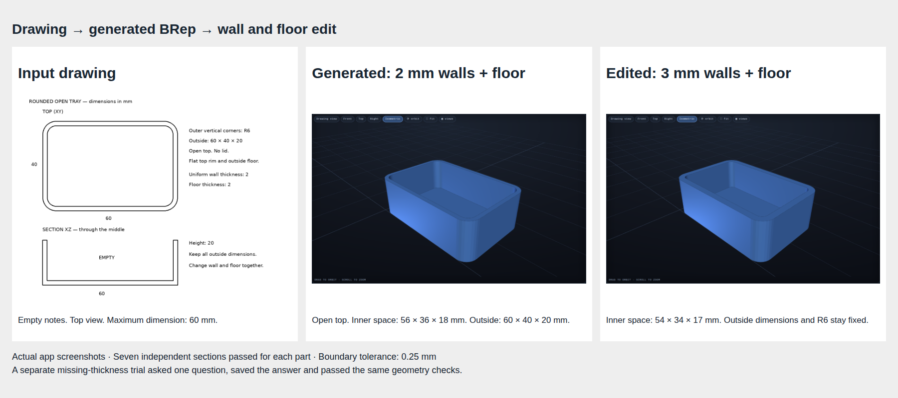

# Task 12 — Generate and edit a hollow tray

Issue: #29. Target branch: `brep-integration`. Base: `5336a5d`.

The app can now remove the top face of a solid and make walls inward. The outside stays fixed. This first shell operation uses the same thickness for the walls and floor.

## What the user can do

Draw an open tray with outside dimensions 60 × 40 × 20 mm and R6 vertical corners. Specify 2 mm walls and floor. The app generates a native hollow part. Change the thickness to 3 mm in the parameter panel. The cavity changes from 56 × 36 × 18 mm to 54 × 34 × 17 mm. The outside dimensions stay fixed.

If the drawing does not specify thickness, the app asks for it. The missing-thickness trial answered 2 mm through the actual app form. The question and answer are saved with the result. The app also supports separate wall and floor questions when the design needs different values. Such a design uses explicit subtraction; the new shell operation itself has one uniform thickness.

## Evidence

- `trial-01/`: live drawing generation, original and edited STL/USDA files, recipes, screenshots, edit responses and detailed report. Job `47c1365a747d`.
- `missing-01/`: live generation with one thickness question, saved answer, original and edited files and report. Job `49983158d2e2`.
- `reference/`: independent checks of the known recipe at 2 mm and 3 mm. A solid-box negative control fails.
- `probe/`, `probe.txt`, `kernel-api.txt`: native API probe and exported native bodies, including the failed excessive-thickness attempt.
- `tests.txt`: 198 tests passed. One existing Starlette/httpx deprecation warning remains.
- `ui-controls.json`: browser tests for wall, floor, uniform thickness, through-hole and recess payloads. A delayed answer response cannot hide the next question. These tests mock the answer endpoint; they do not prove geometry.
- `ui-controls-initial-error.txt`: retained initial browser-test timing failure. The test now waits for each response; a separate test covers overlapping responses.
- `regressions/`: the agreed four drawings plus a seeded random drawing. Read `summary.json` for every outcome. A request for clarification is recorded and cancelled, not answered by guesswork.

Each tray has seven independently checked sections: five horizontal sections and two vertical sections. The tests check both cavity and outside boundaries, volume, a closed mesh and one connected component. The largest section error is below 0.057 mm against a 0.25 mm limit. The invalid edit leaves the displayed part and downloads intact. Native shell thickness 25 mm is rejected because it removes the interior or floor.

**The general app drawing comparison reports a failed top projection in both live tray trials.** The detailed geometry checks pass; this does not make the general comparison pass. These are separate results. Reload also still returns the original part. Saving the selected edited version is task 13, issue #30.

## Scope and limits

The opening is the single planar highest face. The shell goes inward and must preserve the outside bounds. Unsupported faces or invalid solids fail with a feature-specific message. This is not a general shell tool for arbitrary selected faces, separate wall/floor offsets, or manufacturing certification.

Live runs use the configured local Qwen3.8 Flash Next model, `drawing-brep-18` and `construction-intent-11`, on a separate server at port 8104 and result directory `results/brep29`. No notes were added to the drawing trials. Random seed `20261019` is a selection identifier, not the run date.

## Reproduce

Use the repository application environment and the separate native BRep worker environment. Run the modules `scripts.check_shell_reference`, `scripts.check_shell_product`, `scripts.check_shell_regressions` and `scripts.check_thickness_controls`. `BREP_INPUT` selects the missing-thickness drawing; `BREP_TRIAL` selects its evidence directory. Saved request IDs let the product and regression scripts resume without silently generating replacement attempts.

The wheel's saved recipe was also replayed with the previous worker at `4dff087` (the implementation merged by `5336a5d`). It failed at the same `union_2` operation with the same invalid-solid message. See `regressions/wheel/baseline-replay/`. This shows that this exact geometry failure is reproducible before the shell change. It does not prove that all new model interpretations are unchanged.

The knob regression requested `uniform_thickness` for overall solid depth. That question kind is intended for walls and floor, so this is a model interpretation error, not a successful clarification example. The run was cancelled without inventing an answer. The cable holder built but failed the drawing comparison. These failures remain visible in the evidence and must inform the final generation-path assessment (#34).

Final regression outcomes: wheel failed a native union (also reproduced with the previous worker); cable holder built but failed drawing comparison; bookend, knob and seeded random vent grille requested clarification and were cancelled. No regression run is reported as a clean accepted generation.
