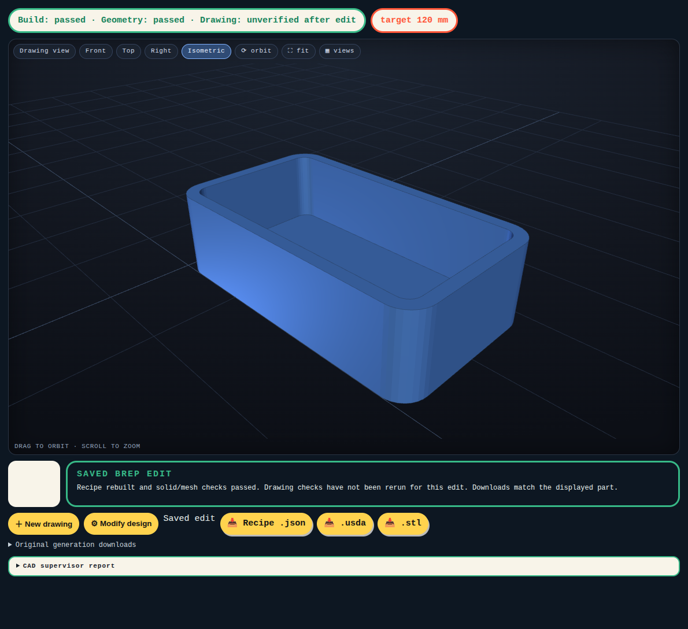

# Task 13 — Keep edits and recover the same part

Issue #30. Branch `codex/brep-13-revisions`. Base `efb21a8`; target `brep-integration` only.

## What changed

A successful preview is now a separate design version. **Keep this edit** makes it the saved version. **Discard preview** returns to the saved version. Reload, including after a server restart, restores the selected recipe, parameters, mesh and native download together.

Each new edit uses the part currently displayed. It does not silently start again from the original generation. The original files and generation report remain available. Drawing checks for an edited part are marked unverified; a successful geometry build does not prove drawing fidelity.

## Actual app demonstration

The test imports the saved rounded-tray recipe. This is a native editing demonstration, not a fresh drawing-generation claim.

1. Original: outside 60 × 40 × 20 mm, walls and floor 2 mm.
2. Preview 3 mm walls and floor; keep it.
3. Change outside width to 70 mm; keep it. The second recipe retains the first edit's 3 mm thickness.
4. Reload: the saved part and both parameter values return. Downloads match this version.
5. Preview 4 mm thickness; discard it. The saved 3 mm version returns.
6. Try 25 mm thickness. The native build rejects it; the saved version stays intact.
7. Restart the server. The same saved version still returns.

`product-final/report.json` records the successful real browser actions. The edited mesh is closed, has one component and measures 70 × 40 × 20 mm. `product-final/recovery-report.json` records server restart recovery and rejection of an old delayed preview response. That delayed-response test uses a mocked response containing an earlier native candidate; it tests browser ordering, not a new geometry build.

All original and edited recipes, STL and USDA files are in `product-final/artifacts/d25b1ad87303/`. The earlier `product/` evidence includes the unsuccessful first browser test's built candidate. The final complete demonstration is in `product-final/`. Nothing was replaced to hide that attempt. `initial-browser-error.txt` records a Playwright argument error corrected in the test script. Earlier screenshots retain the initial wrong “Original” badge on a saved edit; `server-restart.png` shows the corrected label.

## Storage and request rules

`revisions.json` is the shared version-history contract for parameter edits and future targeted repairs (#16/#32). It has a schema version, selected ID, selection counter and immutable records. A record contains its ID, parent ID, source, parameters and result snapshot with files and validation data. The original generation is the root. Old results are read without rewriting their original files.

- `POST /api/results/{id}/revisions/preview`: displayed parent ID, selection counter and parameter changes. A build makes a candidate only.
- `POST /api/results/{id}/revisions/keep`: candidate ID and expected selection counter. A conflicting save returns 409.
- `GET /api/results/{id}` and `/api/results/latest`: selected saved result.
- `GET /api/results/{id}/params?revision_id=...`: parameters for the displayed version.

A file lock and atomic replacement protect selection changes. Builds run outside the lock. The server rechecks the selection counter after a build. Browser guards reject older requests and mesh responses. A discarded preview remains in history for evidence but is not selected. The existing OpenSCAD parameter endpoint remains compatible. A full history browser and the targeted repair workflow are not part of this task.

## Validation and limits

The unit tests cover two different parameter edits, inherited values, immutable original files, reload selection, invalid previews, unknown revisions, concurrent keeps and a selection change during a build. The native browser demonstration covers actual meshes, downloads, keep, discard and reload. The full suite includes OpenSCAD regression checks: **203 tests passed**, with one existing Starlette/httpx deprecation warning.

The first suite exposed a parameter-read compatibility bug for old recipe folders without a completed result; it is fixed. A later suite exposed a cancellation-test scheduling race: the child had received SIGKILL but its exit was not yet visible immediately after the parent exited. The test now waits at most one second for the child to stop; the kill behavior is unchanged. Both failure logs are retained.

The five fresh generation probes are in `regressions/`. Wheel, bookend, knob and cable holder requested clarification and were cancelled without guessed answers. Seeded random `102_lcd_knob` built but failed drawing comparison. These are not clean accepted-generation results. The revision feature does not fix the model's drawing interpretation or the general comparison failures.
