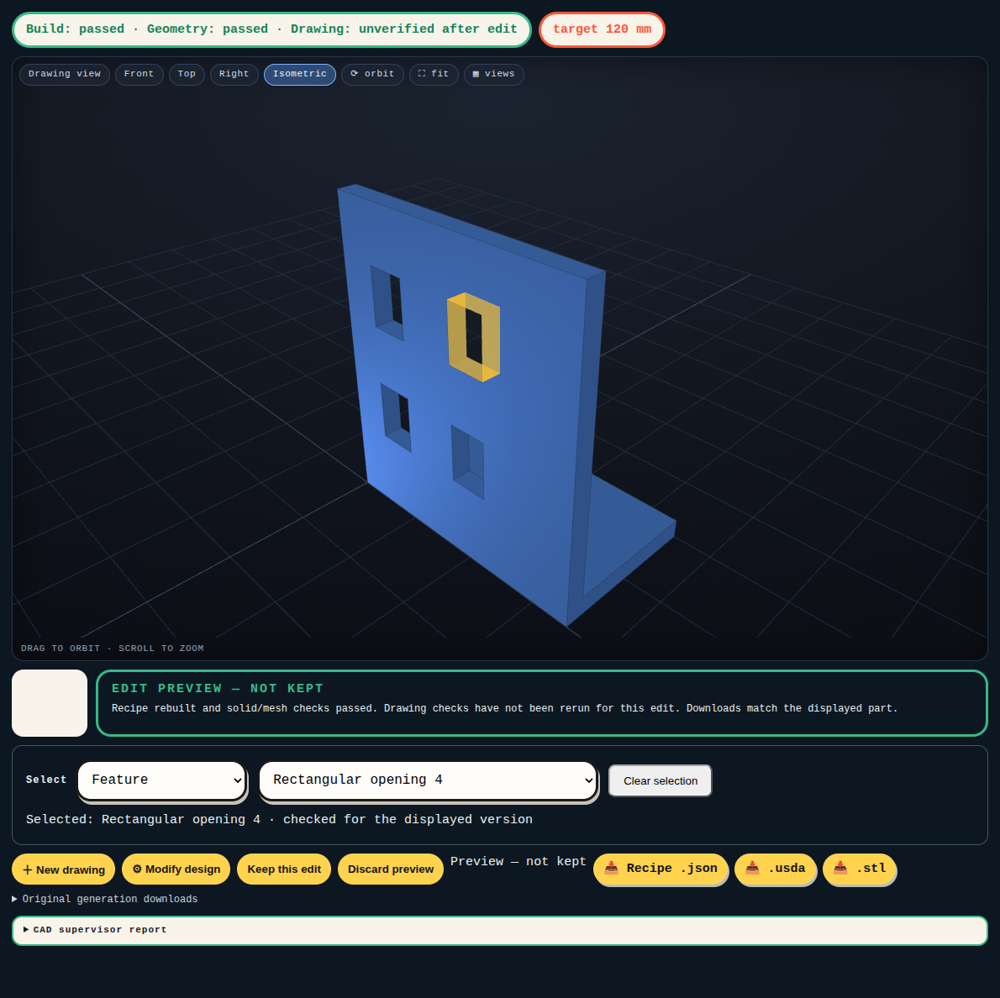

# Task 14 — Keep the correct geometry selected after a rebuild

Issue #31. Branch `codex/brep-14-selection`, based on `9945a23`. Target: `brep-integration`. Main stays at `2672a6d`.

## What the user can do

Choose Feature, Face or Outer edge group below the existing viewer. Pick a listed target or click visible geometry. The selected faces or edges turn yellow. The app saves the owning feature, geometric rule and design revision. It does not treat a native face number as a permanent identity.

Select the upper-right opening in the bookend. Change the width from 60 to 70 mm. The same opening stays highlighted. Move that opening outside the body: the app clears the highlight and reports a lost target. It does not select another hole. Discard the preview to restore the saved part and its valid selection.

A separate fixture moves a bridge into the opening, splitting it into two openings. The app reports an ambiguous target and clears the highlight. This fixture is an explicit selection test, not a claimed interpretation of a new doodle.

## Product evidence

`product-final/report.json` records four native builds with actual app selections and parameter edits:

| Case | Edit | Result |
| --- | --- | --- |
| Bookend opening | Width 60 → 70 mm | Same four cutout walls stay selected |
| Bookend opening | Move hole X to 90 mm, outside the body | Target lost; no highlight; discard restores selection |
| Rounded enclosure face | Wall/floor thickness 2 → 3 mm | Same outside X-max face stays selected |
| Outer vertical edges | Bookend width 60 → 70 mm | Same rule identifies the four outer vertical edges |
| Split opening | Move test bridge Z from 40 to 56 mm | Target ambiguous; no highlight; discard restores selection |

The camera and orbit target remain fixed within 0.0000001 mm. Reload restores the saved selection. Each case includes screenshots, original and edited recipes, STL/USDA files, native diagnostics and the saved revision history.

`picking-report.json` verifies a real browser click on a visible native face. A separate test limits the picker to a rear face, verifies that the ray intersects that face, then checks that the visible front surface blocks the click. This controlled picker test isolates occlusion behavior. It does not alter the displayed solid.

## Checks and failures retained

**211 tests passed**, including the existing OpenSCAD suite. One existing Starlette/httpx deprecation warning remains. Tests cover moved, removed, unused and split features; internal-edge exclusion; saved selection and conflicting requests; and native catalogs before and after a split.

The first browser assertion compared floating-point camera values for exact equality. Recorded differences were about 0.0000000000003 mm. The test now uses the stated 0.0000001 mm limit. `initial-browser-failure.txt` retains that failure.

The first split fixture exposed a real ownership-trace bug: the worker's resolved recipe omits the `depends_on` metadata. The matcher now follows the actual `left`, `right` and `body` references as well. Native tests verify that all four bookend cutouts remain reachable through a later union. `initial-product-log.txt` and `product/` retain the earlier partial attempt. `product-final/` is the complete demonstration.

`selection-api.txt`, `native-probe.txt` and `native-probe/` contain the initial kernel API probe and exported bodies. Optional `pxr` warnings remain in the raw export log; the native files were written.

## Fresh drawing regressions

The agreed wheel, bookend, knob and cable holder were run, plus seeded random `011_wall_hook`. All requests and outcomes are in `regressions/`.

- Wheel failed a native solid operation. Its exact recipe fails with the previous worker too; see `wheel/baseline-replay/`.
- Bookend asked for clarification and was cancelled without a guessed answer.
- Knob returned an invalid clarification plan.
- Cable holder returned mismatched recipe dependencies.
- Random wall hook built, but failed the drawing comparison. Its mesh, native export and screenshot are saved.

These are not accepted-generation results. Reliable selection of an existing checked part does not fix drawing interpretation or general drawing-comparison failures.

## Supported rules and limits

This first implementation supports axis-aligned extreme planar faces, four-wall openings made by box cutters, and straight vertical edges at the outer XY corners. Native closest-point checks map the highlight to actual trimmed faces. Internal edges are excluded from the outer group. A changed or missing match clears the overlay and requests a new selection. Old results without the catalog need a new build before geometry selection is available.

The build publishes a selection catalog in its diagnostics. If optional catalog construction fails, the checked part remains available and selection is marked unavailable. The app saves only a server-validated catalog rule, label and revision context. A selection counter rejects delayed conflicting choices; the existing revision counter rejects choices against an obsolete saved design. Selection controls are disabled during a build or pending choice.

No universal topology-naming guarantee is claimed. This issue establishes selection and tracking. Applying a requested geometric change to the selected target is #32.
