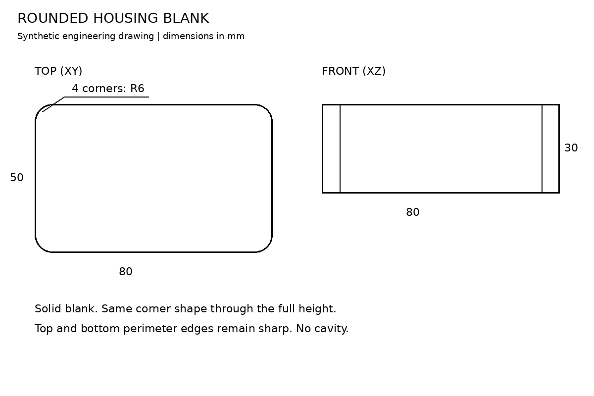
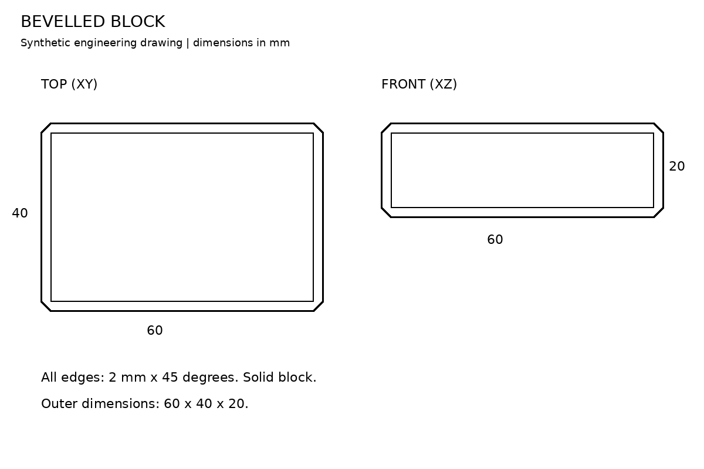
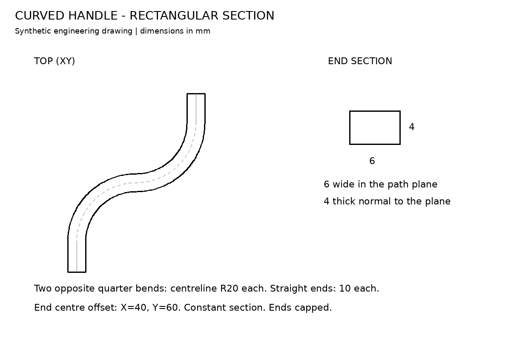

# Issue 42: drawings and checks for richer geometry

Status: ready for user review. No generated parts in this task.

The [selection and acceptance contract](../../../benchmarks/brep-features/README.md)
contains six feature cases: a circular-section handle, a rounded housing blank,
a bevelled block, a rectangular-section handle, a solid transition and an
ambiguous outline. It also fixes five regression inputs. The additional random
case is `102_lcd_knob`.

The existing handle, transition and ambiguous outline are reused without changes.
Three new dimensioned engineering diagrams fill gaps in the corpus. They are
synthetic fixtures, not evidence that the model can infer these parts yet.

## Evidence

- [Selection, hashes, evidence regions, checks and edit constraints](../../../benchmarks/brep-features/selection.json)
- [Input audit](input-audit.json): all 11 input records pass.
- Model calls: **0**. Model settings and attempt history: not applicable.
- Geometry builds: **0**. New 3D artifacts: not applicable.
- Existing OpenSCAD evidence and its limits are linked in the contract.
- Application code, prompt and kernel changes: **none**.

The input audit checks hashes, image sizes, evidence-region bounds, empty notes,
empty hints, reference paths and the saved random selection. It does not test
whether a generated part matches a drawing. A visual inspection checked the
new diagrams and their dimension labels. User review is still pending.

## Development and review

Task branch: `codex/brep-42-feature-corpus`.
Base: `brep-integration` at `6eb322336d531d7ce1307d3ced3966c7f1756b76`.
The task uses a separate worktree. The active PR #41 checkout and its unrelated
local files are preserved. `main` is unchanged.

Review the selected drawings, dimensions, edits and tolerances. Record approval
or requested changes in issue #42. Do not close it before that review. Do not
merge PR #41 as part of this task. The next implementation is #24, after the
required #23 and #42 reviews pass. Then #43 demonstrates existing BRep operations.

## New drawings

### Rounded housing blank

### Bevelled block

### Rectangular-section curved handle

