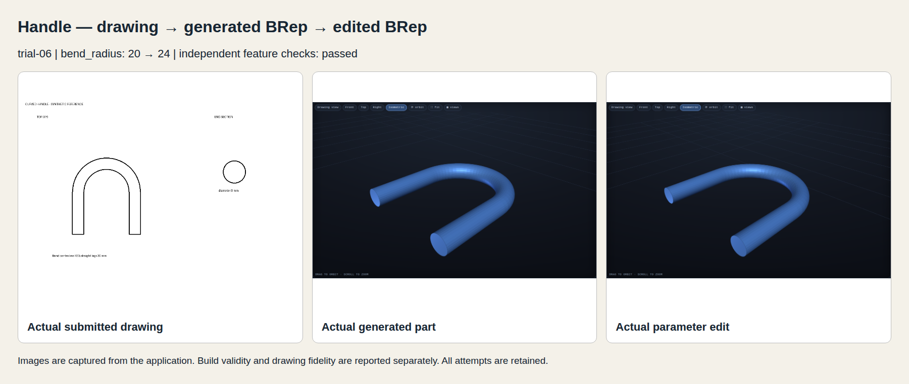
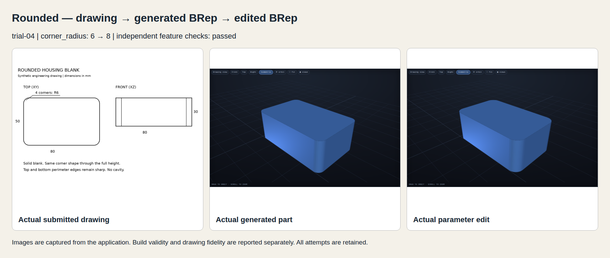
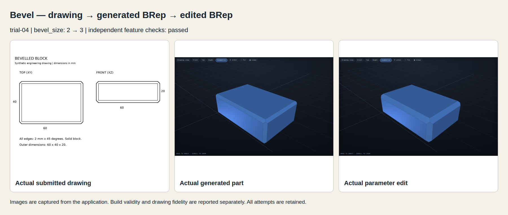
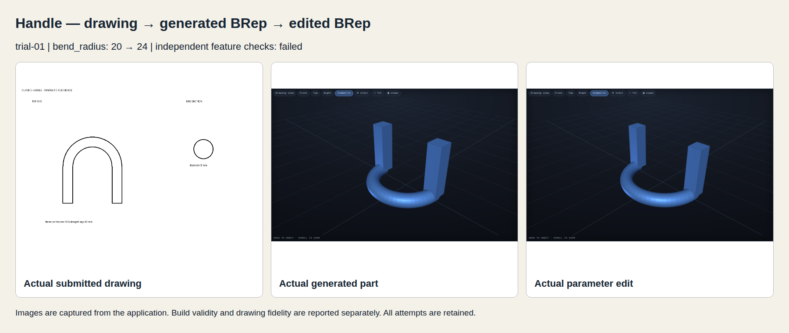
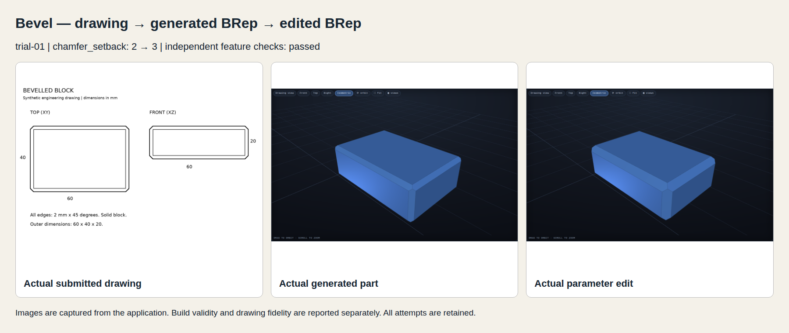
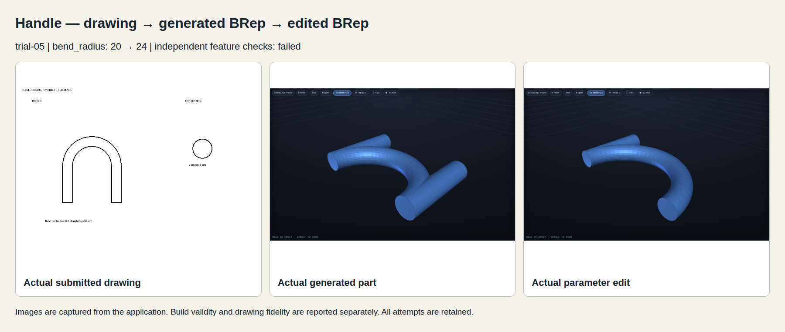

# Drawing checks and richer BRep generation

Issues #24 and #43. Development target: `brep-integration`. `main` is unchanged.

## Verified achievements

PR #45 adds separate build, solid and drawing results. It checks each opening in the required view. It also adds independent mesh-section checks with positive and negative controls. PR #46 adds a saved construction plan and clearer geometry rules before direct BRep generation. OpenSCAD remains the default.

The rounded housing and bevelled block were generated from drawings with empty notes. They were then edited through the app. No reference recipe was substituted. The measured results below use trial 04.

| Feature | App edit | Outer dimensions before and after | Maximum measured contour error, before / after |
|---|---|---|---|
| Housing corner radius | 6 → 8 mm | 80 × 50 × 30 mm | 0.05535 / 0.05700 mm |
| Block bevel setback | 2 → 3 mm | 60 × 40 × 20 mm | 0.04972 / 0.04933 mm |

The contour tolerance is 0.25 mm. Housing sections are checked at five heights, including near both ends. The bevel is checked in three perpendicular middle sections. Both parts retain their outer bounds within 0.05 mm after the edit. These checks validate these specific shapes; they do not establish a general capability for every drawing.

## Scope and interpretation of results

The product now distinguishes build, geometry and drawing checks. It checks projections and openings in their required views. Exact radii, sections and preserved dimensions are measured independently in this benchmark. A passing build alone does not establish drawing fidelity. Product candidates remain unverified where view assignment or detailed features need review.

The richer path saves a drawing-grounded construction plan before the recipe. It records planes, section shapes, dimensions, endpoint placement, connections, edit rules and unresolved assumptions. The plan is generated by the model; it is not a reference recipe or proof of correctness.

Generation guidance distinguishes rounds from bevels, preserves sharp edge families and links useful parameters to dependent placements. Chamfer setback is converted to the kernel width across the bevel. Existing positive-overlap constraints cannot be weakened during correction.

## Curved handle result

Trial 06 passes the independent checks before and after a bend-radius edit from 20 to 24 mm. The expected outer envelope changes from 48 × 54 × 8 to 56 × 58 × 8 mm. The circular section remains Ø8 mm and the straight legs remain 30 mm long. The exported mesh has small tessellation error; exact measured extents and section errors are in [trial-06/measurements.json](trial-06/measurements.json).

Earlier handle trials failed because of a wrong plane, wrong section, malformed plan, a joint constraint, or legs that pointed in the wrong direction. Prompt version 10 states the positive-axis rule for cylinder height and requires both endpoints to be computed. This is a general primitive rule, not a saved handle recipe.

## Selected generation and edit evidence



[Handle measurements](trial-06/measurements.json) · [Edited recipe](trial-06/handle/edited.recipe.json) · [Edited STL](trial-06/handle/edited.stl) · [Edited USDA](trial-06/handle/edited.usda)



[Housing measurements](trial-04/measurements.json) · [Edited recipe](trial-04/rounded/edited.recipe.json) · [Edited STL](trial-04/rounded/edited.stl) · [Edited USDA](trial-04/rounded/edited.usda)



[Bevel measurements](trial-04/measurements.json) · [Edited recipe](trial-04/bevel/edited.recipe.json) · [Edited STL](trial-04/bevel/edited.stl) · [Edited USDA](trial-04/bevel/edited.usda)

## Review and integration

PR [45](https://github.com/nedraki/doodle-to-cad/pull/45) supplies issue #24. PR [46](https://github.com/nedraki/doodle-to-cad/pull/46) supplies issue #43 and includes the dependent drawing-check commit. Both target `brep-integration`. Review and merge #45 first. Neither PR is merged by this report. User review of the visible results remains open.

Task branches: `codex/brep-07-drawing-checks` and `codex/brep-43-richer-generation`. The initial implementation commits are `f1fef67` and `f3bd3b4`. The final PR also includes the later coordinate-rule change and this evidence. The protected main commit is `2672a6d64cb020b39fa50e1062443d6b1dc345aa`.

## Trial history

All submitted BRep trials are listed below. Early failures, schema failures and kernel failures are retained. Changes between trials are development work, not independent statistical samples. No success rate or general superiority claim follows from this small development set.

| Trial | Case | Run | Build | Independent original checks | Edit checks | Protected dimensions |
|---|---|---|---|---|---|---|
| [trial-01](trial-01/summary.json) | handle | `380a11dfb55d` | done | failed | failed | False |
| [trial-01](trial-01/summary.json) | rounded | `7b45159647ab` | done | passed | passed | True |
| [trial-01](trial-01/summary.json) | bevel | `b36ec8f1021d` | done | passed | passed | True |
| [trial-01](trial-01/summary.json) | wheel | `7e8c4edd8a46` | done | geometry only | geometry only | not measured |
| [trial-01](trial-01/summary.json) | bookend | `f93b743503c5` | done | geometry only | geometry only | not measured |
| [trial-01](trial-01/summary.json) | knob | `2f61e3c02587` | done | geometry only | geometry only | not measured |
| [trial-01](trial-01/summary.json) | cable_holder | `36944a7566f2` | error | build_failed | not measured | not measured |
| [trial-01](trial-01/summary.json) | random_lcd_knob | `b11d5b1b961a` | done | geometry only | geometry only | not measured |
| [trial-02](trial-02/summary.json) | handle | `fe2953b34772` | done | failed | not measured | not measured |
| [trial-03](trial-03/summary.json) | handle | `a4fe51b15ccd` | error | build_failed | not measured | not measured |
| [trial-03](trial-03/summary.json) | rounded | `310da0a22f1d` | error | build_failed | not measured | not measured |
| [trial-04](trial-04/summary.json) | handle | `f94e16e9796c` | error | build_failed | not measured | not measured |
| [trial-04](trial-04/summary.json) | rounded | `710295b8f6e1` | done | passed | passed | True |
| [trial-04](trial-04/summary.json) | bevel | `0e9954eecef0` | done | passed | passed | True |
| [trial-04](trial-04/summary.json) | wheel | `cd79d4bc586e` | done | geometry only | geometry only | not measured |
| [trial-04](trial-04/summary.json) | bookend | `08f7fa3a3d77` | done | geometry only | geometry only | not measured |
| [trial-04](trial-04/summary.json) | knob | `96e522a7a7ed` | done | geometry only | geometry only | not measured |
| [trial-04](trial-04/summary.json) | cable_holder | `2bcf17c897d7` | done | geometry only | geometry only | not measured |
| [trial-04](trial-04/summary.json) | random_lcd_knob | `fabda095b201` | error | build_failed | not measured | not measured |
| [trial-05](trial-05/summary.json) | handle | `856f2bf6400d` | done | failed | failed | False |
| [trial-06](trial-06/summary.json) | handle | `fd25f0d2381a` | done | passed | passed | True |

## Regression checks

Trial 04 uses the construction plan and recipe prompt version 8. The later handle trials test prompt changes separately. Do not interpret those targeted trials as a full regression run of the final prompt.

| Input | Generation | Browser edit / download / rejection / reload | Drawing checks |
|---|---|---|---|
| Wheel | Built | Passed | Failed projections; fidelity is not accepted |
| Bookend | Built | Passed | Unverified detailed features |
| Stepped knob | Built | Passed | Unverified detailed features |
| Cable holder | Built | Passed | Failed projections and openings |
| Recorded random LCD knob | Failed | No completed result to edit | Native chamfer failed with SM_ERR1001 |

[Regression measurements](trial-04/measurements.json) · [Browser checks](trial-04/product-report.json). The initial trial 01 and all failures remain in the history. The random input was fixed before these trials; it was not replaced after failure.

The bevel passes the independent dimensions and section checks but fails the coarse drawing checker. Its inferred view/opening interpretation needs work. Both results are retained. A detailed benchmark pass does not silently override a product warning.

## Detailed evidence

Each trial stores the submitted drawing and controls, input hash, job result, model responses, prompts, generated recipe, native 3D files and diagnostics. Successful product tests also store screenshots, edited recipe/STL/USDA, invalid-edit rejection and reload checks. Configured model settings are in [run-settings.json](run-settings.json); trial prompt versions are in [trial-versions.json](trial-versions.json); actual model identity and prompt versions are also in each generation record.

Normal form controls and the drawing are generation inputs. The expected-feature contract, reference geometry and section measurements are not supplied to the model. The production checker contains no benchmark lookup.

### Handle — trial-01



[Measurements](trial-01/measurements.json) · [Product checks](trial-01/product-report.json) · [Saved artifacts](trial-01/handle/artifacts)

### Rounded — trial-01


[Measurements](trial-01/measurements.json) · [Product checks](trial-01/product-report.json) · [Saved artifacts](trial-01/rounded/artifacts)

### Bevel — trial-01



[Measurements](trial-01/measurements.json) · [Product checks](trial-01/product-report.json) · [Saved artifacts](trial-01/bevel/artifacts)

### Rounded — trial-04


[Measurements](trial-04/measurements.json) · [Product checks](trial-04/product-report.json) · [Saved artifacts](trial-04/rounded/artifacts)

### Bevel — trial-04


[Measurements](trial-04/measurements.json) · [Product checks](trial-04/product-report.json) · [Saved artifacts](trial-04/bevel/artifacts)

### Handle — trial-05



[Measurements](trial-05/measurements.json) · [Product checks](trial-05/product-report.json) · [Saved artifacts](trial-05/handle/artifacts)

### Handle — trial-06


[Measurements](trial-06/measurements.json) · [Product checks](trial-06/product-report.json) · [Saved artifacts](trial-06/handle/artifacts)

## Same-input OpenSCAD comparison

These runs use the same drawings, empty notes and normal controls. They are a diagnostic comparison, not a benchmark of backend capability. A geometry that failed generation may still be constructible in OpenSCAD. No fallback result replaces a failed BRep candidate.

| Case | Run | Existing evaluator accepted | Independent feature checks |
|---|---|---|---|
| handle | `5f5b7591c5d4` | False | failed |
| rounded | `6f706c6b9710` | True | failed |
| bevel | `09b67225eae9` | False | failed |

[OpenSCAD raw trials and native SCAD/STL](openscad-comparison/summary.json) · [Comparison measurements](openscad-comparison/comparison-report.json)

## Limits

- General sweeps, lofts, hollow-body tools and face-selection editing are not added here.
- A construction plan can contain contradictions. It must be checked against the drawing and the resulting geometry.
- Native pipe unions can fail for near-coincident overlaps. Failed jobs publish no completed result.
- Projection checks are coarse and view assignment can be wrong. The app does not claim detailed drawing acceptance from those scores.
- Reload restores the original generation. Edited native files are saved, but the later revision-history task defines persistent selection of an edited revision.
- Final recipe prompt changes have targeted handle coverage; the whole eight-input suite was run on prompt version 8, not on every later wording change.
- Synthetic engineering diagrams do not establish handwriting robustness. The bookend and other agreed regressions remain in the trial set.

## Validation and reproduction

Final test result: **133 passed**, with one existing Starlette/httpx deprecation warning. The isolated BRep worker was enabled for this run.

See [tests.txt](tests.txt) for the final test run. Deterministic positive/negative geometry checks and their native files are in [task 07](../task-07/README.md). The browser tests verify geometry-changing parameters, matching downloads, invalid-edit rejection and original-result reload.

```sh
export DOODLE_BREP_PYTHON=/path/to/workers/brep/.venv/bin/python
export DOODLE_TEST_URL=http://127.0.0.1:8094
export BREP_TRIAL=trial-new
python -m scripts.check_brep_drawing_features
python scripts/run_richer_brep_trials.py
python scripts/check_richer_brep_product.py
python -m scripts.measure_richer_brep
python scripts/render_richer_evidence.py
python -m scripts.check_openscad_rich_comparison
python scripts/report_richer_brep.py
```

Use a separate BRep server and result directory. Set `DOODLE_TEST_URL`, `BREP_TRIAL` and optional `BREP_CASES` before a live run. Use a new trial directory for each rerun. Pin the isolated worker through `DOODLE_BREP_PYTHON`. Never change the saved thresholds to make a candidate pass.
